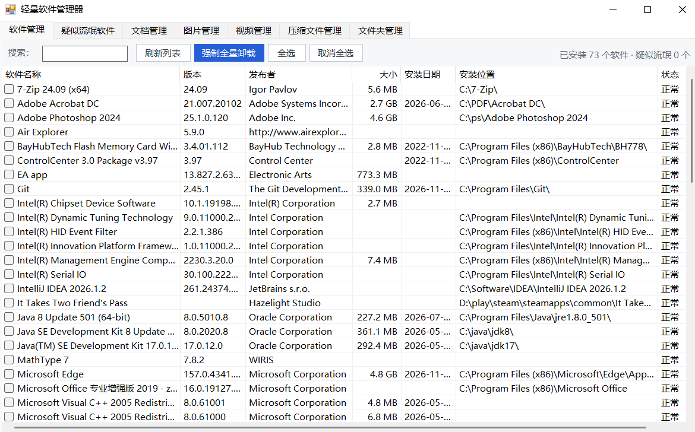
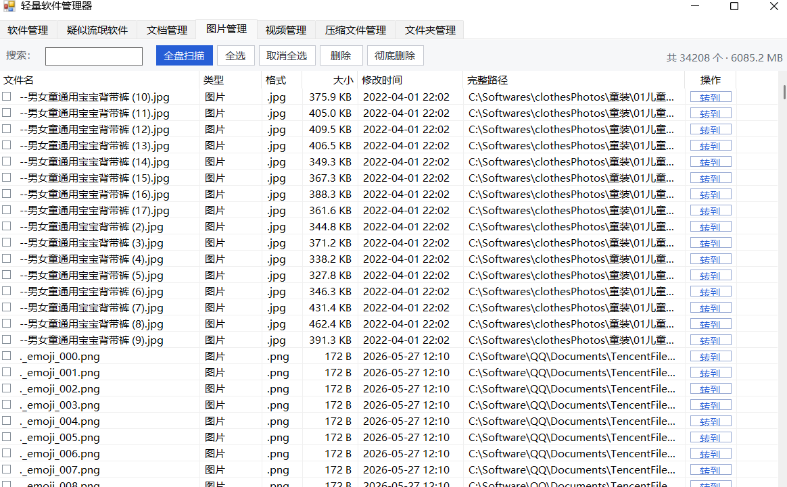
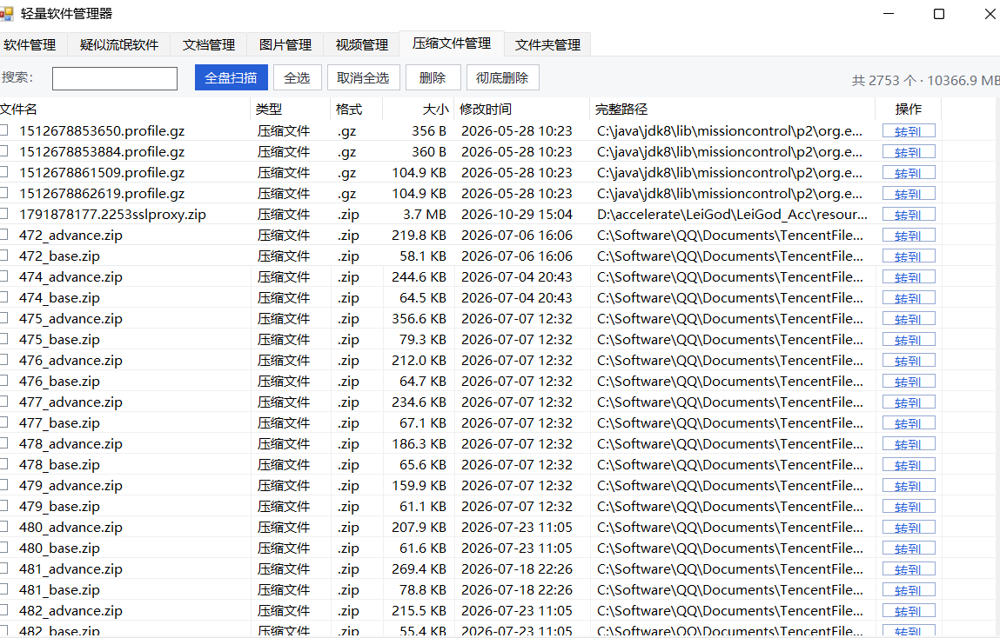

# 轻量软件管理器 LiteManager

一个 **约 88 KB 单文件绿色版** 的 Windows 小工具：强制卸载软件并深度清理残留、识别疑似流氓软件、按类型批量管理和强删文件（文档 / 图片 / 视频 / 压缩包 ）、文件夹搜寻，所有列表都能点列头排序。

- 单文件 exe，**不用安装**，双击就能跑，不写系统目录、不装服务、不联网
- 无第三方依赖、无 NuGet 包，只用 .NET Framework 自带的 WinForms
- **完全免费开源**，MIT 协议，随便用、随便改

---

## 运行方式

1. 下载 `bin/LiteManager.exe`
2. 双击运行；第一次会弹一次 UAC 授权框，点「是」（卸载软件、结束占用进程、接管文件权限需要管理员权限）
3. 打开后自动开始全盘扫描，扫完在 7 个页签里直接看/操作

也可以把 `bin/LiteManager.exe` 改成任意名字，或复制到 U 盘里带走，配置不留痕（除卸载/删除操作本身会改目标目录和注册表）。

---

## 功能截图

**软件管理**：列出本机全部已安装软件，支持搜索、全选、强制全量卸载


**疑似流氓软件**：多维度打分，只有你勾选并确认后才动手


**文档管理**：Word / Excel / PPT / PDF / 文本 / 其他，全盘搜索，右侧「转到」直接跳转定位


**图片管理**：单独页签，全盘搜索全部显示，勾选后可批量删除或彻底删除


**视频管理**：mp4 / mkv / mov / avi / flv / rmvb / webm 等


**压缩文件管理**：zip / rar / 7z / tar / gz / iso / cab / apk / jar 等


**文件夹管理**：全盘文件夹列表，每行「打开此文件夹」直接开资源管理器


---

## 自己编译（不需要 Visual Studio）

只用系统自带的 csc.exe，一条命令出 70 KB 的 exe：

```bat
"C:\Windows\Microsoft.NET\Framework64\v4.0.30319\csc.exe" /nologo /target:winexe /codepage:65001 /optimize+ ^
  /win32icon:src\app.ico /win32manifest:src\app.manifest ^
  /r:System.dll /r:System.Core.dll /r:System.Drawing.dll /r:System.Windows.Forms.dll /r:Microsoft.VisualBasic.dll ^
  /out:bin\LiteManager.exe src\LiteManager.cs
```

注意：csc 4.0 只支持 C# 5 语法，所以源码里没有字符串插值（`$""`）、没有 `?.`、没有 `nameof`。

---

## 代码是怎么实现的

整个程序只有一个文件 `src/LiteManager.cs`（约 2700 行，纯 C# + WinForms），核心是 7 个模块：

### 1. 已安装软件列表 —— `AppLoader`
遍历三个注册表卸载键：
`HKLM\SOFTWARE\Microsoft\Windows\CurrentVersion\Uninstall`、
`HKLM\SOFTWARE\WOW6432Node\...\Uninstall`、
`HKCU\SOFTWARE\Microsoft\Windows\CurrentVersion\Uninstall`，
读出 `DisplayName / DisplayVersion / Publisher / InstallLocation / EstimatedSize / InstallDate / UninstallString / QuietUninstallString`，
再用 `FileVersionInfo` 和目录大小补齐版本、体积、修改日期，过滤掉系统更新补丁（KB 项）。

### 2. 卸载引擎 —— `Uninstaller`
- 先打分：无发布者、发布者未知、没有卸载入口、没有卸载命令也没有安装目录、装在临时/下载目录、名字含「助手/卫士/管家/加速/全家桶/破解/去广告」等推广词、主程序无数字签名。≥45 分进「疑似流氓」，≥70 分标红高风险。
- 卸载顺序：MSI 走 `msiexec /x {GUID} /qn`；Inno Setup 走 `/VERYSILENT /SUPPRESSMSGBOXES /NORESTART`；NSIS 走 `/S`；其他直接跑 UninstallString。
- 卸不干净就兜底：结束占用进程 → 删安装目录 → 删开始菜单/桌面快捷方式 → 删注册表卸载项 → 删 `AppData`/`ProgramData` 残留。`C:\Windows` 下的系统组件只删注册表、不删目录。

### 3. 强制删除引擎 —— `FileForce`（解决「访问被拒绝」）
按梯度升级，前面能成就停：
1. 清掉只读/隐藏/系统属性，直接 `File.Delete`；
2. 用 **Restart Manager**（`rstrtmgr.dll` 的 `RmStartSession` / `RmRegisterResources` / `RmGetList`）查出到底是哪个进程占着这个文件，然后结束它（`explorer / svchost / csrss / winlogon / services / lsass / smss / wininit / dwm` 这些系统进程跳过，避免搞崩系统）；
3. `takeown /f` + `icacls /grant *S-1-5-32-544:F` 把所有权和完全控制权拿过来；
4. 还不行就用系统底层 `cmd /c del /f /q`，目录用 `rd /s /q` 递归兜底；
5. 仍被独占（`.lock` / `.lck` 这类句柄没放开）→ 用 `CreateFile` 带 `FILE_FLAG_DELETE_ON_CLOSE` 打开后立即关闭，句柄一关文件就没了；再不行把文件改名到 `~lm_del_xxx` 随机名（打破路径锁）再删；
6. 最后手段：`MoveFileEx(..., MOVEFILE_DELAY_UNTIL_REBOOT)` 写进 `PendingFileRenameOperations`，**重启时由系统在加载任何进程之前删掉**，并在日志里注明「已登记重启后自动删除」。
超过 240 字符的长路径自动加 `\\?\` 前缀。目录删除是「先逐文件强删、再逐层删空目录」，树里剩下的死角同样走第 5、6 步登记，所以只读、被占用、权限不足、带锁文件的目录树都能清掉。

### 4. 全盘扫描 —— `DocScanner`
- 扫描**所有就绪的固定盘和移动盘**（U 盘 / 移动硬盘也扫；光驱、未就绪盘、网络盘不碰）；
- **不再按名字跳过任何目录**：`AppData`、`Temp`、`cache`、`node_modules`、`.git`、`ProgramData`、`Windows`、`Program Files` 全部进列表；只排除回收站（`$Recycle.Bin`）和 `System Volume Information`；
- 用 Win32 `FindFirstFileW` 逐条枚举（不是 `Directory.GetFiles`）：单个坏条目 / 无权限子目录不会连累同级的其他目录；长路径统一加 `\\?\` 前缀，超过 260 字符也能正常枚举；
- 每个目录的「卷序列号 + 文件索引」用来去重：`junction` / 软链 / 云盘目录照常进入，但同一个真实目录只深入一次，不会死循环、也不会重复计数；
- 仅跳过系统为兼容旧程序保留的旧式 `junction`（`Application Data`、`Local Settings`、`My Documents`、`Documents and Settings` 这类别名），它们的目标目录本身会被单独扫到，跳过别名反而能保证内容不漏；
- 用栈做迭代式深度遍历（不用递归，避免深目录爆栈），一次遍历同时产出「文件列表 + 文件夹列表」；
- 按扩展名映射成 9 个类别：Word / Excel / PPT / PDF / 文本 / 其他文档 / 图片 / 视频 / 压缩文件；**不设文件数 / 目录数上限**，扫到磁盘没有为止（唯一限制是内存，内存耗尽时会保留已有结果并提示）；
- 每扫 500 个文件回调一次进度，UI 侧再按 300 ms 节流刷新状态栏（显示文件数 / 文件夹数）。

### 5. 界面 —— 单 Form + TabControl + 虚拟列表
- 7 个页签：软件管理 / 疑似流氓软件 / 文档管理 / 图片管理 / 视频管理 / 压缩文件管理 / 文件夹管理，每页顶部都有搜索框 + 进度条，文件类页面还有 全选 / 取消全选 / 删除 / 彻底删除；
- 3 万～10 万行的列表用 **ListView VirtualMode + OwnerDraw 自绘**：不创建任何 ListViewItem 对象，只按可视区域回调取数据，所以 10 万行也能秒开、不卡；勾选框、行高亮、「转到」按钮全部自绘，勾选状态存在自己的 `List<bool>` 里，每页独立；
- 扫描跑在后台线程，页签按需填充（`Dirty` 标记 + 选中时懒加载），扫描期间随便切页都不卡；
- 窗口 `AutoScaleMode.None` + `dpiAware`，高 DPI 下布局不飘。

### 6. 排序与重绘细节
- **点列头排序**：`ColumnClick` → `SortCatView` / `SortFolderView`，记录 `SortCol / SortAsc`，点同一列切换升序（▲）/ 降序（▼），箭头直接写进列头文字；
- 虚拟列表排序不能动控件，做法是排一份**下标数组**，再按新顺序重建 `View` 和与之平行的 `Chk`（勾选状态），所以排序后勾选跟着文件走、不会串行；重新扫描完成时如果已有排序列，会自动再套一遍排序；


## 适用范围与已知边界

这是一个通用工具，不是为本机定制的：所有目录、账户、盘符都来自系统环境（`Environment.GetFolderPath`、`SpecialFolder`、`GetLogicalDrives`），关键词来自注册表卸载项与安装信息动态推导，源码里没有任何本机用户名、软件名或固定盘符。下面这些边界同样如实列出：

- **系统**：只支持 Windows；需要 .NET Framework 4.0+（Win8 / 10 / 11 自带，Win7 需先安装）
- **权限**：清单里 `requireAdministrator`，必须用管理员账户启动，否则无法结束进程、接管权限、写 `PendingFileRenameOperations`
- **扫不到的目录**：账户完全无读取权限（ACL 拒绝）的目录，其内容无法枚举，会跳过该目录本身（同一级的其他目录不受影响）；系统还原点 `System Volume Information`、回收站 `$Recycle.Bin` 也不扫
- **界面**：只有简体中文；窗口固定 1180×700，1024×768 的老机器放不下，1366×768 及以上正常
- **架构**：AnyCPU 编译，32 位 / ARM64 未实机验证，理论上可跑
- **内存**：扫描结果全部驻留内存（约 150～200 字节/项），不设数量上限；几百 G 的盘、上百万文件建议 64 位系统 + 8 GB 以上内存，内存真不够时会保留已扫结果并提示
- **其他账户**：会扫描 `C:\Users\*` 下其他账户的 AppData / LocalLow / 用户根（有权限才清），但**不加载**其他账户的注册表 HKCU（需挂载 NTUSER.DAT，风险高，未实现）
- **关键词是启发式的**：极短、极大众的软件名（例如只叫 `QQ`）理论上可能多命中同名前缀目录；程序内置通用词黑名单、`DcSkip` / `DcShellName` 跳过表与 `DcSafeDir` 安全阀兜底，但仍建议首次使用时核对结果框列出的对象
- **系统组件保护**：`Windows` 目录下或「Microsoft 发布者 + Microsoft 名称」的程序只调用官方卸载，不删快捷方式、数据目录与卸载注册表项
- **重启删除**：被独占句柄死死抓住的文件无法立即删，会登记进 `PendingFileRenameOperations`，**下一次重启**才真正消失，日志里会写明
- **回收站**：只有「删除」走回收站；「彻底删除」与卸载清理都直接抹除，不可恢复

## 目录说明

```
LiteManager/
├─ bin/LiteManager.exe      # 编译好的 88 KB 成品
├─ src/LiteManager.cs       # 全部源码（单文件）
├─ src/app.manifest         # requireAdministrator + dpiAware
├─ src/app.ico              # 图标
├─ 使用说明.txt              # 中文使用手册
└─ screenshots/             # 上面 7 张界面截图
```

## 更新日志

- 不再按文件数 / 目录数截断，扫到磁盘没有为止；内存耗尽时保留已扫到的结果并在状态栏提示
- 去掉所有按目录名的跳过规则（AppData / Temp / cache / node_modules / .git / ProgramData / Windows 等全部纳入）、支持 U 盘移动硬盘、长路径 `\\?\`、Win32 逐条枚举避免整目录失败、卷序列号去重防止 junction 死循环
- 勾选复选框不再整表刷新闪白（双缓冲 + 按行局部重绘）
- 六个页面支持点列头排序（▲升序 / ▼降序）——软件管理按 名称 / 版本 / 发布者 / 大小 / 安装日期 / 安装位置 / 状态；文档、图片、视频、压缩文件按 文件名 / 类型 / 格式 / 大小 / 修改时间 / 完整路径；文件夹按 文件夹名 / 完整路径。排序后勾选状态跟随文件

## 协议

MIT License —— 完全免费，可商用、可修改、可再分发，保留版权声明即可。

> 提醒：卸载软件、彻底删除文件都不可撤销，程序执行前会弹确认框并列出具体对象，请核对后再确认。

