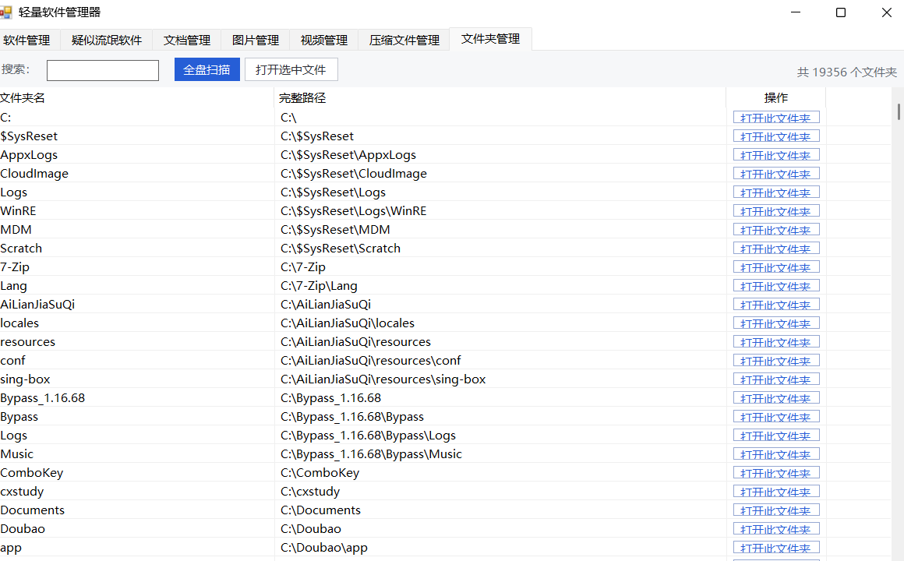

# 轻量软件管理器 LiteManager

一个 **65 KB 单文件绿色版** 的 Windows 小工具：强制卸载软件、识别疑似流氓软件、按类型批量管理和强删文件（文档 / 图片 / 视频 / 压缩包 ）、文件夹搜寻。

- 单文件 exe，**不用安装**，双击就能跑，不写系统目录、不装服务、不联网
- 无第三方依赖、无 NuGet 包，只用 .NET Framework 自带的 WinForms
- **完全免费开源**，MIT 协议，随便用、随便改

---

## 运行方式

1. 下载 `bin/LiteManager.exe`
2. 双击运行；第一次会弹一次 UAC 授权框，点「是」（卸载软件、结束占用进程、接管文件权限需要管理员权限）
3. 打开后自动开始全盘扫描，扫完在 7 个页签里直接看/操作

也可以把 `bin/LiteManager.exe` 改成任意名字，或复制到 U 盘里带走，配置不留痕（除卸载/删除操作本身会改目标目录和注册表）。

---

## 功能截图

**软件管理**：列出本机全部已安装软件，支持搜索、全选、强制全量卸载


**疑似流氓软件**：多维度打分，只有你勾选并确认后才动手


**文档管理**：Word / Excel / PPT / PDF / 文本 / 其他，全盘 1 万+ 文档，右侧「转到」直接跳转定位


**图片管理**：单独页签，3 万+ 图片全部显示，勾选后可批量删除或彻底删除


**视频管理**：mp4 / mkv / mov / avi / flv / rmvb / webm 等


**压缩文件管理**：zip / rar / 7z / tar / gz / iso / cab / apk / jar 等


**文件夹管理**：全盘文件夹列表，每行「打开此文件夹」直接开资源管理器


---

## 自己编译（不需要 Visual Studio）

只用系统自带的 csc.exe，一条命令出 65 KB 的 exe：

```bat
"C:\Windows\Microsoft.NET\Framework64\v4.0.30319\csc.exe" /nologo /target:winexe /codepage:65001 /optimize+ ^
  /win32icon:src\app.ico /win32manifest:src\app.manifest ^
  /r:System.dll /r:System.Core.dll /r:System.Drawing.dll /r:System.Windows.Forms.dll /r:Microsoft.VisualBasic.dll ^
  /out:bin\LiteManager.exe src\LiteManager.cs
```

注意：csc 4.0 只支持 C# 5 语法，所以源码里没有字符串插值（`$""`）、没有 `?.`、没有 `nameof`。

---

## 代码是怎么实现的

整个程序只有一个文件 `src/LiteManager.cs`（约 2200 行，纯 C# + WinForms），核心是 5 个模块：

### 1. 已安装软件列表 —— `AppLoader`
遍历三个注册表卸载键：
`HKLM\SOFTWARE\Microsoft\Windows\CurrentVersion\Uninstall`、
`HKLM\SOFTWARE\WOW6432Node\...\Uninstall`、
`HKCU\SOFTWARE\Microsoft\Windows\CurrentVersion\Uninstall`，
读出 `DisplayName / DisplayVersion / Publisher / InstallLocation / EstimatedSize / InstallDate / UninstallString / QuietUninstallString`，
再用 `FileVersionInfo` 和目录大小补齐版本、体积、修改日期，过滤掉系统更新补丁（KB 项）。

### 2. 卸载引擎 —— `Uninstaller`
- 先打分：无发布者、发布者未知、没有卸载入口、没有卸载命令也没有安装目录、装在临时/下载目录、名字含「助手/卫士/管家/加速/全家桶/破解/去广告」等推广词、主程序无数字签名。≥45 分进「疑似流氓」，≥70 分标红高风险。
- 卸载顺序：MSI 走 `msiexec /x {GUID} /qn`；Inno Setup 走 `/VERYSILENT /SUPPRESSMSGBOXES /NORESTART`；NSIS 走 `/S`；其他直接跑 UninstallString。
- 卸不干净就兜底：结束占用进程 → 删安装目录 → 删开始菜单/桌面快捷方式 → 删注册表卸载项 → 删 `AppData`/`ProgramData` 残留。`C:\Windows` 下的系统组件只删注册表、不删目录。

### 3. 强制删除引擎 —— `FileForce`（解决「访问被拒绝」）
按梯度升级，前面能成就停：
1. 清掉只读/隐藏/系统属性，直接 `File.Delete`；
2. 用 **Restart Manager**（`rstrtmgr.dll` 的 `RmStartSession` / `RmRegisterResources` / `RmGetList`）查出到底是哪个进程占着这个文件，然后结束它（`explorer / svchost / csrss / winlogon / services / lsass / smss / wininit / dwm` 这些系统进程跳过，避免搞崩系统）；
3. `takeown /f` + `icacls /grant *S-1-5-32-544:F` 把所有权和完全控制权拿过来；
4. 还不行就用系统底层 `cmd /c del /f /q`，目录用 `rd /s /q` 递归兜底。
超过 240 字符的长路径自动加 `\\?\` 前缀。目录删除是「先逐文件强删、再逐层删空目录」，所以只读、被占用、权限不足的目录树都能清掉。

### 4. 全盘扫描 —— `DocScanner`
- 只扫**固定磁盘**（`DriveType.Fixed`），U 盘/光驱/网络盘不碰；
- 跳过 `Windows`、`Program Files`、`Program Files (x86)`、`ProgramData`、`$Recycle.Bin`、`System Volume Information`、`Recovery` 等系统目录；
- 用栈做迭代式深度遍历（不用递归，避免深目录爆栈），一次遍历同时产出「文件列表 + 文件夹列表」；
- 按扩展名映射成 9 个类别：Word / Excel / PPT / PDF / 文本 / 其他文档 / 图片 / 视频 / 压缩文件，上限 30 万文件、20 万目录；
- 每扫 500 个文件回调一次进度，UI 侧再按 300 ms 节流刷新状态栏。

### 5. 界面 —— 单 Form + TabControl + 虚拟列表
- 7 个页签：软件管理 / 疑似流氓软件 / 文档管理 / 图片管理 / 视频管理 / 压缩文件管理 / 文件夹管理，每页顶部都有搜索框 + 进度条，文件类页面还有 全选 / 取消全选 / 删除 / 彻底删除；
- 3 万～10 万行的列表用 **ListView VirtualMode + OwnerDraw 自绘**：不创建任何 ListViewItem 对象，只按可视区域回调取数据，所以 10 万行也能秒开、不卡；勾选框、行高亮、「转到」按钮全部自绘，勾选状态存在自己的 `List<bool>` 里，每页独立；
- 扫描跑在后台线程，页签按需填充（`Dirty` 标记 + 选中时懒加载），扫描期间随便切页都不卡；
- 窗口 `AutoScaleMode.None` + `dpiAware`，高 DPI 下布局不飘。

---

## 目录说明

```
LiteManager/
├─ bin/LiteManager.exe      # 编译好的 65 KB 成品
├─ src/LiteManager.cs       # 全部源码（单文件）
├─ src/app.manifest         # requireAdministrator + dpiAware
├─ src/app.ico              # 图标
├─ 使用说明.txt              # 中文使用手册
└─ screenshots/             # 上面 7 张界面截图
```

## 协议

MIT License —— 完全免费，可商用、可修改、可再分发，保留版权声明即可。

> 提醒：卸载软件、彻底删除文件都不可撤销，程序执行前会弹确认框并列出具体对象，请核对后再确认。
