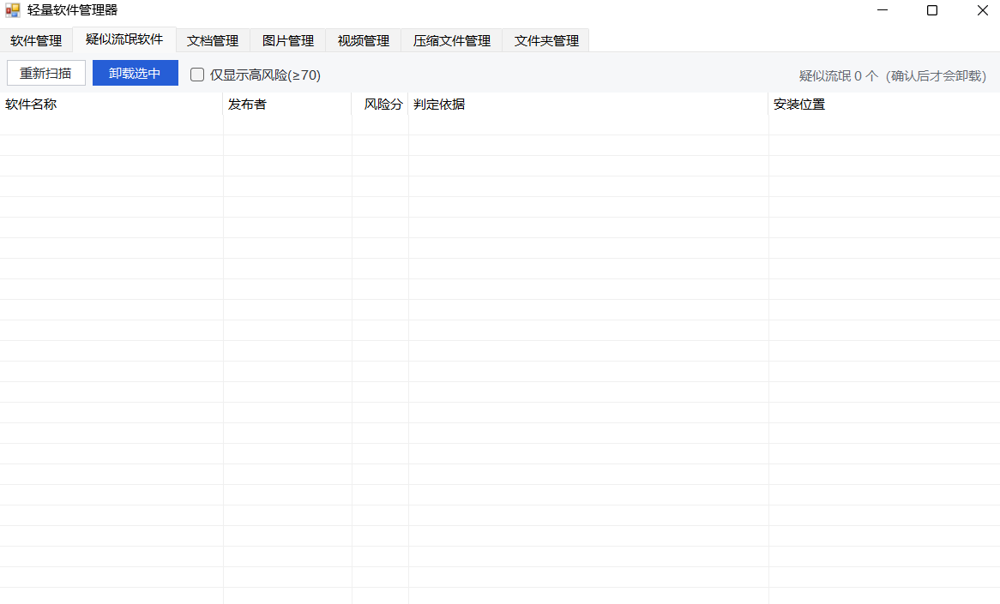
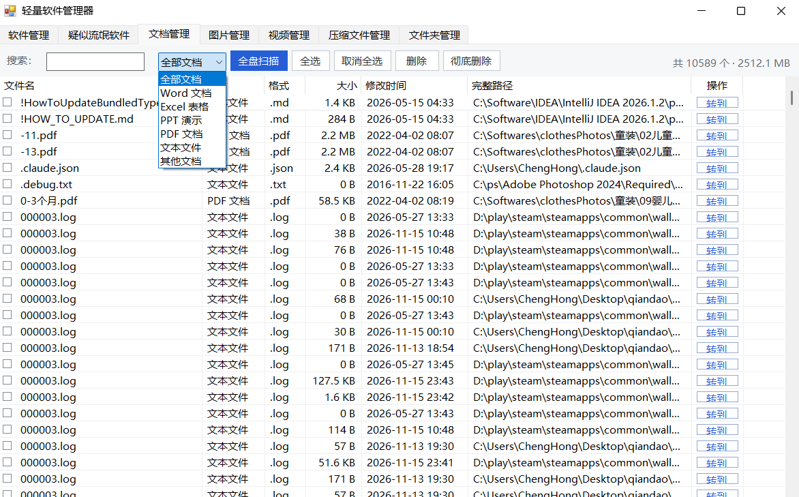
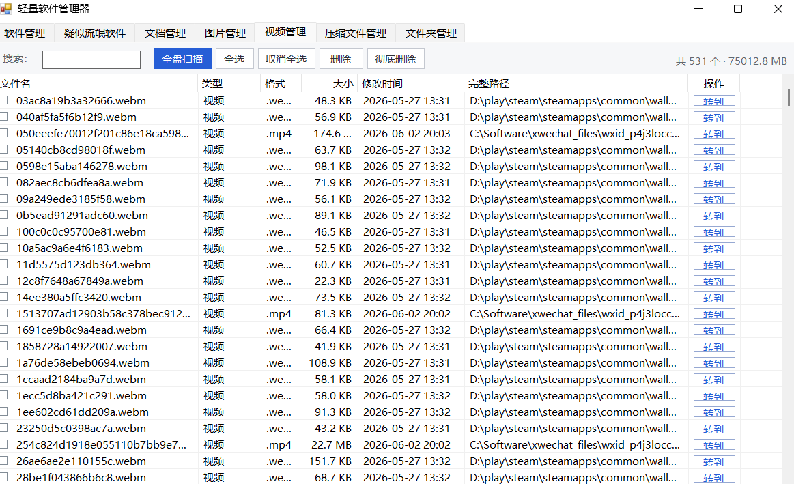

# 轻量软件管理器 LiteManager

一个 **约 84 KB 单文件绿色版** 的 Windows 小工具：强制卸载软件并深度清理残留、识别疑似流氓软件、按类型批量管理和强删文件（文档 / 图片 / 视频 / 压缩包 ）、文件夹搜寻，所有列表都能点列头排序。

- 单文件 exe，**不用安装**，双击就能跑，不写系统目录、不装服务、不联网
- 无第三方依赖、无 NuGet 包，只用 .NET Framework 自带的 WinForms
- **完全免费开源**，MIT 协议，随便用、随便改

---

## 运行方式

1. 下载 `bin/LiteManager.exe`
2. 双击运行；第一次会弹一次 UAC 授权框，点「是」（卸载软件、结束占用进程、接管文件权限需要管理员权限）
3. 打开后自动开始全盘扫描，扫完在 7 个页签里直接看/操作

也可以把 `bin/LiteManager.exe` 改成任意名字，或复制到 U 盘里带走，配置不留痕（除卸载/删除操作本身会改目标目录和注册表）。

---

## 功能截图

**软件管理**：列出本机全部已安装软件，支持搜索、全选、强制全量卸载


**疑似流氓软件**：多维度打分，只有你勾选并确认后才动手


**文档管理**：Word / Excel / PPT / PDF / 文本 / 其他，全盘搜索，右侧「转到」直接跳转定位


**图片管理**：单独页签，全盘搜索全部显示，勾选后可批量删除或彻底删除


**视频管理**：mp4 / mkv / mov / avi / flv / rmvb / webm 等


**压缩文件管理**：zip / rar / 7z / tar / gz / iso / cab / apk / jar 等


**文件夹管理**：全盘文件夹列表，每行「打开此文件夹」直接开资源管理器


---

## 自己编译（不需要 Visual Studio）

只用系统自带的 csc.exe，一条命令出 70 KB 的 exe：

```bat
"C:\Windows\Microsoft.NET\Framework64\v4.0.30319\csc.exe" /nologo /target:winexe /codepage:65001 /optimize+ ^
  /win32icon:src\app.ico /win32manifest:src\app.manifest ^
  /r:System.dll /r:System.Core.dll /r:System.Drawing.dll /r:System.Windows.Forms.dll /r:Microsoft.VisualBasic.dll ^
  /out:bin\LiteManager.exe src\LiteManager.cs
```

注意：csc 4.0 只支持 C# 5 语法，所以源码里没有字符串插值（`$""`）、没有 `?.`、没有 `nameof`。

---

## 代码是怎么实现的

整个程序只有一个文件 `src/LiteManager.cs`（约 2700 行，纯 C# + WinForms），核心是 7 个模块：

### 1. 已安装软件列表 —— `AppLoader`
遍历三个注册表卸载键：
`HKLM\SOFTWARE\Microsoft\Windows\CurrentVersion\Uninstall`、
`HKLM\SOFTWARE\WOW6432Node\...\Uninstall`、
`HKCU\SOFTWARE\Microsoft\Windows\CurrentVersion\Uninstall`，
读出 `DisplayName / DisplayVersion / Publisher / InstallLocation / EstimatedSize / InstallDate / UninstallString / QuietUninstallString`，
再用 `FileVersionInfo` 和目录大小补齐版本、体积、修改日期，过滤掉系统更新补丁（KB 项）。

### 2. 卸载引擎 —— `Uninstaller`
- 先打分：无发布者、发布者未知、没有卸载入口、没有卸载命令也没有安装目录、装在临时/下载目录、名字含「助手/卫士/管家/加速/全家桶/破解/去广告」等推广词、主程序无数字签名。≥45 分进「疑似流氓」，≥70 分标红高风险。
- 卸载顺序：MSI 走 `msiexec /x {GUID} /qn`；Inno Setup 走 `/VERYSILENT /SUPPRESSMSGBOXES /NORESTART`；NSIS 走 `/S`；其他直接跑 UninstallString。
- 卸不干净就兜底：结束占用进程 → 删安装目录 → 删开始菜单/桌面快捷方式 → 删注册表卸载项 → 删 `AppData`/`ProgramData` 残留。`C:\Windows` 下的系统组件只删注册表、不删目录。

### 3. 强制删除引擎 —— `FileForce`（解决「访问被拒绝」）
按梯度升级，前面能成就停：
1. 清掉只读/隐藏/系统属性，直接 `File.Delete`；
2. 用 **Restart Manager**（`rstrtmgr.dll` 的 `RmStartSession` / `RmRegisterResources` / `RmGetList`）查出到底是哪个进程占着这个文件，然后结束它（`explorer / svchost / csrss / winlogon / services / lsass / smss / wininit / dwm` 这些系统进程跳过，避免搞崩系统）；
3. `takeown /f` + `icacls /grant *S-1-5-32-544:F` 把所有权和完全控制权拿过来；
4. 还不行就用系统底层 `cmd /c del /f /q`，目录用 `rd /s /q` 递归兜底。
超过 240 字符的长路径自动加 `\\?\` 前缀。目录删除是「先逐文件强删、再逐层删空目录」，所以只读、被占用、权限不足的目录树都能清掉。

### 4. 全盘扫描 —— `DocScanner`
- 只扫**固定磁盘**（`DriveType.Fixed`），U 盘/光驱/网络盘不碰；
- 跳过 `Windows`、`Program Files`、`Program Files (x86)`、`ProgramData`、`$Recycle.Bin`、`System Volume Information`、`Recovery` 等系统目录；
- 用栈做迭代式深度遍历（不用递归，避免深目录爆栈），一次遍历同时产出「文件列表 + 文件夹列表」；
- 按扩展名映射成 9 个类别：Word / Excel / PPT / PDF / 文本 / 其他文档 / 图片 / 视频 / 压缩文件，上限 30 万文件、20 万目录；
- 每扫 500 个文件回调一次进度，UI 侧再按 300 ms 节流刷新状态栏。

### 5. 界面 —— 单 Form + TabControl + 虚拟列表
- 7 个页签：软件管理 / 疑似流氓软件 / 文档管理 / 图片管理 / 视频管理 / 压缩文件管理 / 文件夹管理，每页顶部都有搜索框 + 进度条，文件类页面还有 全选 / 取消全选 / 删除 / 彻底删除；
- 3 万～10 万行的列表用 **ListView VirtualMode + OwnerDraw 自绘**：不创建任何 ListViewItem 对象，只按可视区域回调取数据，所以 10 万行也能秒开、不卡；勾选框、行高亮、「转到」按钮全部自绘，勾选状态存在自己的 `List<bool>` 里，每页独立；
- 扫描跑在后台线程，页签按需填充（`Dirty` 标记 + 选中时懒加载），扫描期间随便切页都不卡；
- 窗口 `AutoScaleMode.None` + `dpiAware`，高 DPI 下布局不飘。

### 6. 排序与重绘细节
- **点列头排序**：`ColumnClick` → `SortCatView` / `SortFolderView`，记录 `SortCol / SortAsc`，点同一列切换升序（▲）/ 降序（▼），箭头直接写进列头文字；
- 虚拟列表排序不能动控件，做法是排一份**下标数组**，再按新顺序重建 `View` 和与之平行的 `Chk`（勾选状态），所以排序后勾选跟着文件走、不会串行；重新扫描完成时如果已有排序列，会自动再套一遍排序；

### 7. 深度残留清理 —— `Uninstaller.DeepClean`
卸载程序跑完后还会「卸不干净」，所以 v1.8 加了一层自己的清理器，v1.9 又做了一轮补强。逻辑是**先算关键词，再按关键词找目标，最后逐项强删并校验**：

- **关键词**（v1.9 扩充）：软件显示名剥掉括号、版本号、`64-bit / x64` 后得到主名；再加上 **注册表卸载键名**（`...\Uninstall\Doubao` → `Doubao`）、安装目录名、**卸载程序所在目录**、**图标路径**、静默卸载程序目录，以及名称里 ≥5 字符的分词。这一条解决了「中文显示名 + 英文目录」的经典错配（显示 `豆包`、数据目录叫 `Doubao`）。短于 2 字符、命中 `setup / app / client / temp` 等通用词、`{GUID}`、纯十六进制串一律丢弃。
- **目录匹配**（`DcHit`）：同名即命中；比关键词长时，要求关键词后紧跟分隔符（`空格 - _ . ( [ +`）、数字（`AppName70`）、已知后缀（`cache / data / temp / log / config / updater / webview / crash / app / link / router / htm / pdf ...`）或**驼峰附属组件**（`DoubaoLinkRouter` 这种「关键词 + 大写词根且 ≥6 字符」）。反过来 `AppNameOther`、`AppName2` 这类不同产品不会命中。
- **扫描范围**（v1.9 扩充）：`%LocalAppData%`、`%AppData%`、`%LocalLow%`、`%ProgramData%`、`Temp`、`Programs`、`Packages`，外加 **`C:\Users\<用户名>` 根目录**和「文档」目录下软件自建的数据目录（`C:\Users\xxx\Doubao` 就是这类）。厂商目录（`Tencent`、`Adobe`）**只删里面同名的子目录**，不端整棵厂商树；删完再把变空的厂商目录 `DcPruneEmpty` 顺手清掉。
- **联接点保护**：`C:\Users` 下的 `Application Data`、`Local Settings`、`My Documents` 等是 reparse point，扫描时全部跳过（`DcIsLink` 检查 `FileAttributes.ReparsePoint`），避免顺着联接点删到 `AppData` 里面。
- **注册表**（v1.9 扩充）：`HKCU / HKLM` 的 `Software`、`Software\WOW6432Node` **和 `Software\Classes`**（协议处理器 `doubao://`、右键菜单、文件关联残留都在这里）下同名键、厂商键内同名子键整棵删除；本次删过的父键如果变成空壳，再 `DcPruneEmptyReg` 补一刀；卸载项本身也会重复删一次（幂等）。
- **开机启动**：`Run / RunOnce`（含 WOW6432Node）里名称命中或数据指向安装目录的值删掉，启动文件夹里的同名 `.lnk` 也删。
- **系统服务**（v1.9 修正）：遍历 `HKLM\SYSTEM\CurrentControlSet\Services`，只认 **`ImagePath` 以「安装目录\」开头**的服务；没有安装目录时，必须 **服务名和可执行文件名同时命中关键词** 才动手。原来的「包含匹配」会把 `C:\Program Files` 里所有服务一网打尽，v1.9 已修掉。
- **计划任务**：递归读 `C:\Windows\System32\Tasks` 下的任务文件，内容里出现安装目录的，用 `schtasks /delete /tn <相对名> /f` 删掉。
- **进程**：`KillIn(dir)` 杀掉可执行文件在目标目录内的进程；再加一层 `DcKillByName`，按进程名匹配关键词结束常驻进程（跳过 `explorer / svchost / lsass` 等系统进程、跳过本程序自身），解决「安装目录登记为空、进程却在跑」的情况。
- **临时文件**：`%TEMP%` 下与关键词同名 / 同前缀的文件（`Doubao-1234.log`）一并清掉。
- **安全阀 `DcSafeDir`**：`C:\`、`C:\Windows`、`Program Files`、`ProgramData`、`AppData`、用户目录本体、`Desktop / Documents / Downloads` 这些路径永远判为「不可删」；安装目录若被软件登记成公共目录，删除与服务/任务匹配全部跳过——以前这一条会把整个 `Program Files` 当安装目录删掉，v1.9 已修掉。
- **重试与校验**：删除失败不是直接放弃——`KillIn` 杀占用进程、`DeleteDir` 强删，最多重试 3 轮，仍失败会写进「卸载结果」对话框，提示重启后重试；最后再扫一遍目标列表，确认真的不存在了才算完成。

---

## 目录说明

```
LiteManager/
├─ bin/LiteManager.exe      # 编译好的 84 KB 成品
├─ src/LiteManager.cs       # 全部源码（单文件）
├─ src/app.manifest         # requireAdministrator + dpiAware
├─ src/app.ico              # 图标
├─ 使用说明.txt              # 中文使用手册
└─ screenshots/             # 上面 7 张界面截图
```

## 更新日志

- **v1.9**：深度清理全量加强 + 三处隐性 bug 修复
  - 关键词新增「注册表卸载键名 / 卸载程序目录 / 图标路径」，修掉「显示名是中文、数据目录是英文」的软件清不干净的问题（例：`豆包` 的数据目录 `C:\Users\xxx\Doubao` 以前完全匹配不到）
  - 扫描范围新增 `C:\Users\<用户名>` 根目录与「文档」下的软件数据目录，并跳过 `Application Data` / `Local Settings` 这类联接点
  - 注册表新增 `Software\Classes`（协议处理器、右键菜单、文件关联）；卸载项本身幂等重删
  - 新增按进程名结束常驻进程（跳过系统进程与本程序自身）、`%TEMP%` 同名临时文件清理
  - **修复**：安装目录被登记成 `C:\Program Files` 时会把它当普通目录整个删掉 → 新增 `DcSafeDir` 安全阀
  - **修复**：服务匹配用「包含」判定，安装目录一宽泛就会误删一堆无关服务（曾把 Edge / NVIDIA / Steam 的服务全列进删除名单）→ 改为「ImagePath 必须在安装目录之下」，且按 exe 名判断时要求服务名也命中
  - **修复**：`Uninstaller.Run` 只看进程是否退出、不看退出码，`sc delete` 失败也显示成功 → 改为按 ExitCode 判定
- **v1.8**：强制卸载后新增「深度残留清理」——安装目录（含占用文件重试）、`%AppData%` 系列缓存（同名 / 同名前缀 / 厂商目录内同名子目录 + 空厂商目录回收）、`Software` 下同名注册表键与空壳父键、`Run/RunOnce` 启动项与启动文件夹快捷方式、指向安装目录的系统服务（`sc delete`）、引用安装目录的计划任务（`schtasks /delete`），删完逐项校验并把失败项列进结果框
- 勾选复选框不再整表刷新闪白（双缓冲 + 按行局部重绘）
- 六个页面支持点列头排序（▲升序 / ▼降序）——软件管理按 名称 / 版本 / 发布者 / 大小 / 安装日期 / 安装位置 / 状态；文档、图片、视频、压缩文件按 文件名 / 类型 / 格式 / 大小 / 修改时间 / 完整路径；文件夹按 文件夹名 / 完整路径。排序后勾选状态跟随文件

## 协议

MIT License —— 完全免费，可商用、可修改、可再分发，保留版权声明即可。

> 提醒：卸载软件、彻底删除文件都不可撤销，程序执行前会弹确认框并列出具体对象，请核对后再确认。

